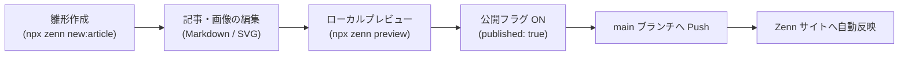

# zenn

技術情報共有プラットフォーム [Zenn](https://zenn.dev/shin4488) の記事コンテンツを管理するリポジトリです。  
`main` ブランチへのプッシュにより、Zenn の GitHub 連携機能を通じて記事が自動的に同期・公開されます。

## 執筆・公開フロー



## 開発・執筆環境

### 1. セットアップ

```bash
npm install
```

### 2. よく使うコマンド

```bash
# 新しい記事のテンプレート作成（articles/ ディレクトリに生成）
npx zenn new:article

# ローカルプレビューサーバの起動（http://localhost:8000 で確認）
npx zenn preview
```

## 記事作成のガイドライン

| 対象 | 置き場所と書き方 |
| --- | --- |
| 記事 | `articles/<スラッグ>.md` に置きます。スラッグは小文字の半角英数字（a-z0-9）・ハイフン・アンダースコアの12〜50字です。 |
| 画像 | `images/<スラッグ>/` に置き、本文からは `/images/<スラッグ>/example.png` の形式で参照します。 |
| 図 | 元データの SVG を `assets/svg/<スラッグ>/` に置き、PNG に書き出して `images/<スラッグ>/` に置きます。書き出し方は [AGENTS.md の図の作成・修正フロー](AGENTS.md#図の作成修正フロー) を参照してください。 |

記事の冒頭のフロントマターで、タイトル、絵文字、記事の種類、トピック、公開状態を設定します。

```markdown
---
title: "記事のタイトル"
emoji: "🚀"
type: "tech" # tech: 技術記事 / idea: アイデア
topics: ["react", "typescript"]
published: false # true で本番公開
---
```

## ディレクトリ構成

```text
zenn/
├── articles/        # 記事 Markdown ファイル
├── images/          # 記事用画像アセット（スラッグごとのサブディレクトリ）
├── assets/          # 作図元ファイル（SVG 等、デプロイ対象外）
└── books/           # Zenn Book 管理用ディレクトリ
```
